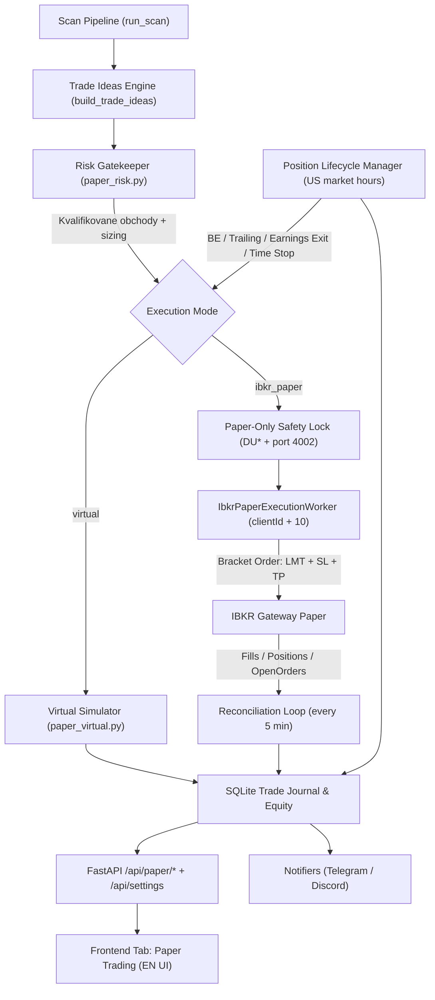

# Návrh a implementační plán: Autonomní Paper Trading & Performance Tracker pro SwingPulse

Tento dokument popisuje kompletní návrh rozšíření platformy **SwingPulse** (`c:\Users\dan\src\stock-screener`, produkce na Raspberry Pi 5 / ARM64) o **autonomní provádění obchodů na Paper účtu (Virtual i IBKR Paper)**, správu otevřených pozic a detailní vyhodnocování úspěšnosti strategie.

Cílem je bezpečně otestovat reálnou statistickou výhodu (edge) současného skórovacího enginu a Trade Ideas v reálném tržním provozu s nulovým finančním rizikem.

---

## 1. Přehled a bezpečnostní politika

### Dual-Mode architektura exekuce
Systém je navržen se **dvěma rovnocennými exekučními režimy** nad stejným Risk Gatekeeperem a stejným Trade Journalem v SQLite:

1. **`virtual` (Lokální simulátor, 100 % read-only vůči IBKR)**
   - Neposílá žádné příkazy do IBKR Gateway (`placeOrder` se vůbec nevolá).
   - Vyhodnocuje vyplnění `Limit` vstupu, `Stop Loss` i `Take Profit` úrovní z tržních dat (IBKR live quotes / Yahoo / `1h` svíčky v SQLite).
   - Ideální pro rychlé ověření chování pravidel bez závislosti na stavu IBKR Gateway či zpožděných datech.
2. **`ibkr_paper` (Autonomní exekuce na IBKR Paper účtu)**
   - Zadává skutečné bracket příkazy přes IBKR Gateway (`port 4002` / `7497`, účet `DU...`).
   - Synchronizuje reálné fill ceny, skluz (slippage), částečná plnění, ruční zásahy i poplatky zpět do SQLite deníku.
   - Při resetu IBKR Paper účtu v Client Portalu lze jedním kliknutím založit v aplikaci nový **Experiment / Account Run** a měřit další sérii obchodů čistě od nuly.

### Úprava bezpečnostní politiky v `AGENTS.md` (Paper-Only Lock)
Současná verze [AGENTS.md](file:///c:/Users/dan/src/stock-screener/AGENTS.md) zakazuje jakékoli volání `placeOrder` v `market_data_ibkr.py`. Pro spuštění režimu `ibkr_paper` bude politika vědomě zpřesněna takto:

- **Čtecí klient (`IbkrSessionWorker`, `market_data_ibkr.py`) zůstává navždy `readonly=True`.**
- **Exekuční klient (`IbkrPaperExecutionWorker`, nový modul `paper_ibkr.py`) je izolovaný** s vlastním `clientId = settings.ibkr_client_id + 10` a před **každým** odesláním nebo úpravou příkazu musí projít tvrdou pojistkou `assert_paper_account()`:
  - Povolený port pouze `4002` (IB Gateway Paper) nebo `7497` (TWS Paper). Jakýkoli jiný port (`4001`, `7496`, ...) vyhodí `LiveAccountBlockedError`.
  - Všemi `ib.managedAccounts()` vrácené ID účtu **musí** začínat prefixem `"DU"` (standard IBKR pro Paper účty; ostré účty mají `"U..."`).
  - Nastavení `order.account` se povinně vyplňuje výhradně ověřeným `"DU..."` účtem.
  - V konfiguraci účtu (`paper_trading` runtime settings) musí být explicitně `enabled=True` a `mode="ibkr_paper"` (výchozí stav po nasazení je `enabled=False`, `mode="virtual"`).

---

## 2. Architektura systému

Autonomní vrstva navazuje na stávající dvouetapový scan (`pipeline.py`) a doporučení (`trade_ideas.py`), aniž by zpomalovala samotný screener nebo porušila limity požadavků (`request_queue.py`).



### Klíčové oddělení vláken a front
- Stávající `ibkr_worker` ([request_queue.py](file:///c:/Users/dan/src/stock-screener/backend/app/core/request_queue.py)) obsluhuje pouze `readonly=True` kotace, opce a HMDS historii.
- Nový `IbkrPaperExecutionWorker` má **vlastní `PriorityQueue` a vlastní spojení** (`readonly=False`, `clientId + 10`) s přísným `SlidingWindowLimiter(max_calls=5, window_seconds=60.0, min_interval=2.0)`, takže nemůže nikdy zahltit IBKR Gateway ani blokovat živé kotace v UI.

---

## 3. Datový model v SQLite (`backend/app/db/models.py`)

Všech 4 nových tabulek využívá stávající SQLite WAL databázi (`/media/pi/Seagate8gb/tickers/screener.db` na `pi5`), atomické transakce a kaskádovou integritu.

### 3.1 `paper_account_runs` (Série / experimenty účtu)
Odděluje jednotlivé testovací běhy (např. před a po resetu IBKR Paper účtu nebo po změně vah presetů):
- `id`: `INTEGER PK`
- `name`: `VARCHAR(80)` (např. `"Baseline v1 - Swing All-Around"`)
- `mode`: `VARCHAR(16)` (`"virtual"` | `"ibkr_paper"`)
- `ibkr_account`: `VARCHAR(24)` (např. `"DU1234567"` nebo `""` u virtual)
- `initial_capital`: `FLOAT` (výchozí `25000.0`)
- `current_equity`: `FLOAT`
- `cash_balance`: `FLOAT`
- `high_water_mark`: `FLOAT`
- `is_active`: `BOOLEAN` (vždy nejvýše jeden aktivní run)
- `kill_switch_triggered`: `BOOLEAN`
- `kill_switch_reason`: `TEXT`
- `started_at`, `ended_at`: `DATETIME(timezone=True)`
- `config_snapshot_json`: `TEXT` (zmrazená kopie risk/sizing parametrů a vah při startu série)

### 3.2 `paper_trades` (Životní cyklus každého obchodu + analytický kontext)
Uchovává plán, reálnou exekuci i kontext signálů v momentě vstupu pro budoucí vyhodnocení:
- **Identifikace a původ:**
  - `id`: `INTEGER PK`
  - `run_id`: `INTEGER FK -> paper_account_runs.id`
  - `symbol`: `VARCHAR(16) FK -> tickers.symbol`
  - `scan_run_id`: `INTEGER FK -> scan_runs.id` (`SET NULL`)
  - `strategy_horizon`: `VARCHAR(24)` (`"short_term"` | `"medium_term"` | `"general"`)
  - `direction`: `VARCHAR(8)` (`"LONG"` | `"SHORT"`)
  - `setup_name`: `VARCHAR(80)`
- **Stav a časová osa:**
  - `status`: `VARCHAR(24)` (`PENDING_ENTRY` | `OPEN` | `PARTIAL_TP1` | `CLOSED` | `CANCELLED` | `REJECTED` | `ERROR`)
  - `created_at`, `submitted_at`, `filled_at`, `closed_at`: `DATETIME`
- **Plán vs. skutečnost (měření slippage):**
  - `planned_entry_low`, `planned_entry_high`, `planned_limit_price`: `FLOAT`
  - `planned_stop_loss`, `planned_tp1`, `planned_tp2`, `planned_rr`: `FLOAT`
  - `current_stop_loss`: `FLOAT` (aktualizuje se při posunu na Break-Even / Trailing)
  - `quantity_planned`, `quantity_filled`, `quantity_remaining`: `INTEGER`
  - `entry_fill_price`, `exit_fill_price`: `FLOAT | NULL`
  - `entry_slippage_bps`: `FLOAT | NULL` (`(fill - planned_limit) / planned_limit * 10000` se znaménkem podle směru)
  - `commission_usd`: `FLOAT` (výchozí `0.0`, aktualizováno z `ib.fills()` / `commissionReport`)
- **Výsledek obchodu:**
  - `risk_amount_usd`: `FLOAT` (`abs(limit_price - stop_loss) * quantity_filled`)
  - `realized_pnl_usd`: `FLOAT`
  - `realized_pnl_pct`: `FLOAT`
  - `unrealized_pnl_usd`: `FLOAT`
  - `r_multiple`: `FLOAT` (`realized_pnl_usd / risk_amount_usd`)
  - `exit_reason`: `VARCHAR(32)` (`TP1_HIT` | `TP2_HIT` | `STOP_LOSS` | `TRAILING_STOP` | `BREAK_EVEN` | `EARNINGS_EXIT` | `TIME_STOP` | `MANUAL_CLOSE` | `ENTRY_EXPIRED` | `EXTERNAL_SYNC`)
- **IBKR vazby a analytický snapshot pro zpětnou diagnostiku:**
  - `ibkr_parent_order_id`, `ibkr_stop_order_id`, `ibkr_tp1_order_id`, `ibkr_tp2_order_id`: `INTEGER | NULL`
  - `ibkr_perm_ids_json`: `TEXT`
  - `conviction_at_entry`: `FLOAT`
  - `composite_score_at_entry`: `FLOAT`
  - `market_regime_at_entry`: `VARCHAR(24)` (`RISK_ON` | `NEUTRAL` | `RISK_OFF`)
  - `sector_at_entry`: `VARCHAR(64)`
  - `signals_at_entry_json`: `TEXT` (seznam kódů signálů typu `LOWER_CHANNEL_TOUCH`, `SMC_AT_BULLISH_OB` atd.)
  - `plugin_scores_at_entry_json`: `TEXT` (skóre jednotlivých analyzátorů při vstupu)

### 3.3 `paper_order_events` (Auditní log všech operací)
- `id`: `INTEGER PK`
- `trade_id`: `INTEGER FK -> paper_trades.id`
- `event_type`: `VARCHAR(32)` (`GATE_APPROVED` | `GATE_REJECTED` | `ORDER_SUBMITTED` | `ORDER_FILLED` | `SL_MOVED_BE` | `SL_TRAILING` | `ORDER_CANCELLED` | `RECONCILED` | `ERROR`)
- `message`: `TEXT`
- `payload_json`: `TEXT`
- `created_at`: `DATETIME`

### 3.4 `paper_equity_snapshots` (Denní equity křivka)
- `id`: `INTEGER PK`
- `run_id`: `INTEGER FK -> paper_account_runs.id`
- `snapshot_date`: `DATE` (unikátní na `(run_id, snapshot_date)`)
- `equity`: `FLOAT`
- `cash`: `FLOAT`
- `open_positions_count`: `INTEGER`
- `realized_pnl_cum`: `FLOAT`
- `unrealized_pnl`: `FLOAT`
- `drawdown_pct`: `FLOAT` (`(equity - high_water_mark) / high_water_mark * 100`)

---

## 4. Vstupní filtry a Risk Gatekeeper (`backend/app/core/paper_risk.py`)

Každý kandidát z `build_trade_ideas()` prochází před zadáním příkazu sérií deterministických bran. Pokud neprojde, důvod odmítnutí se zaloguje, takže jde zpětně ověřit, proč bot obchod nevzal.

### 4.1 Kvalifikační filtry kandidáta
1. **Stáří analýzy:** pouze kandidát z nejnovějšího scanu (`is_latest_scan=True`, stáří snapshotu `< 16 hodin`).
2. **Minimální přesvědčivost & R:R:**
   - `conviction_score >= 68.0` (konfigurovatelné v rozmezí `55..90`),
   - `risk_reward >= 1.8`,
   - směr `LONG` nebo `SHORT` povolen dle konfigurace (`allow_short`: volitelný přepínač, defaultně lze omezit na `False` nebo povolit s přísnějšími limity shortování).
3. **Ochrana před earnings & rizikovými vlajkami:**
   - `days_to_earnings is None` nebo `days_to_earnings > 7` (nikdy neotvíráme těsně před výsledky),
   - nulové blokující `watchouts` (`EARNINGS_IMMINENT`, `NO_INDEX_ALIGN`, `GRADE_D`, `EXTREME_1D_MOVE`, `HIGH_SHORT_INTEREST` pro shorty).
4. **Likvidita a kvalita aktuální ceny:**
   - průměrný denní dolarový objem `AVG(close * volume, 20d) >= $20,000,000` (`` `$20M` ``),
   - čerstvý live quote z IBKR/Yahoo nesmí být starší než `5 min`,
   - `live_status` je `"IN_ZONE"` nebo `"BELOW_ENTRY"` u `LONG` (resp. `"ABOVE_ENTRY"` u `SHORT`) — zakázáno honit cenu ve stavu `"MISSED_ENTRY"`, `"TARGET_HIT"` nebo `"STOP_HIT"`,
   - `bid/ask` spread (pokud je dostupný) `< 0.40 %` ceny.
5. **Režimové zarovnání (`MarketRegime`):**
   - Při `RISK_OFF` snížit max počet nových `LONG` pozic (nebo zvýšit minimální `conviction >= 75`) a upřednostnit sektorové lídry nebo `SHORT` setupy.

### 4.2 Position Sizing (Velikost pozice podle rizika)
Počet akcií se počítá přesně z definovaného rizika účtu, nikoli pevnou částkou:

```text
risk_budget_usd = current_equity * (risk_per_trade_pct / 100.0)   # např. 1.0 % = $250
risk_per_share  = abs(limit_price - stop_loss)
qty_by_risk     = floor(risk_budget_usd / risk_per_share)
max_notional    = current_equity * (max_position_pct_equity / 100.0) # např. 15 % = $3,750
qty_by_cap      = floor(max_notional / limit_price)
quantity        = min(qty_by_risk, qty_by_cap)
```

- Pokud `quantity < 1` nebo `risk_per_share <= 0`, obchod je zamítnut.
- Navíc se hlídá celková alokace (`max_gross_exposure_pct = 90 %` pro bezmaržový baseline test; u `SHORT` kontrola dostupného marginu).

### 4.3 Portfoliové limity a Kill-Switch
- **Max otevřených + pending pozic:** `6` (v `RISK_OFF` např. `3`).
- **Sektorová diverzifikace:** max `2` aktivní pozice ve stejném GICS sektoru (`sector`).
- **Deduplikace a re-entry cooldown:**
  - max `1` aktivní/pending obchod na stejný `symbol`,
  - po zavření ztrátového obchodu (`realized_pnl_usd < 0`) je na daný `symbol` **5denní cooldown**, aby bot neopakoval stejnou chybu každý den.
- **Denní limit aktivity:** max `5` nově otevřených příkazů za jeden obchodní den.
- **Automatický Kill-Switch (pozastaví otevírání nových pozic, stávající SL/TP zůstávají aktivní):**
  - realizovaná + nerealizovaná denní ztráta `<= -2.0 %` vůči začátku dne,
  - celkový drawdown od `high_water_mark` účtu `<= -6.0 %` (vyžaduje ruční odblokování nebo reset série v UI).

---

## 5. Exekuční vrstva a odolnost (`paper_executor.py`, `paper_ibkr.py`)

### 5.1 Bracket Orders v IBKR Paper (`ib_async`)
Místo samostatného vstupu a následného přidání stopky se vždy zadává **kompletní atomická Bracket objednávka**:

1. **Parent Entry Order:** `LimitOrder(action, totalQuantity=qty, lmtPrice=limit_price, tif="DAY", transmit=False)`
   - Pro `LONG` používáme `limit_price = min(current_price_or_ask, entry_high)` s horním stropem v zóně `entry_low..entry_high` (pokud je cena pod zónou a těsně pod `entry_low`, dává se limit na `entry_low`).
   - `tif="DAY"` zaručí, že nevyplněný limitní vstup automaticky vyprší po zavření trhu a nevisí do dalšího dne po nočním gapu.
2. **Child Stop Loss:** `StopOrder(reverse_action, totalQuantity=qty, auxPrice=stop_loss, tif="GTC", parentId=parent.orderId, transmit=False)`
3. **Child Take Profit(y):**
   - Buď jednoduchý `100 %` cíl na `TP1`, nebo **škálovaný výstup (Split 50/50)** pokud je `qty >= 2` (2 samostatné OCA/bracket děti: 50 % na `TP1` a 50 % na `TP2`, každé s příslušným `StopOrder` pro polovinu množství — případně jednodušší varianta Fáze 2: `1× Limit TP2` s `APScheduler` posunem SL na Break-Even při dotyku `TP1`, což se mnohem snáz udržuje v IBKR bez nutnosti dělit stopky).
   - **Doporučení pro spolehlivost v Fázi 2:** Zadávat **1 čistý Bracket (Parent Entry + Stop Loss + Take Profit na `TP1`)** a až v Fázi 3 přidat částečné zavření 50 % na `TP1` + posun SL zbytku na `TP2`.
4. **Poslední child order má `transmit=True`**, takže IBKR aktivuje celou trojici naráz (žádná pozice bez Stop Lossu).

### 5.2 Stavová synchronizace (Reconciliation) proti výpadkům
Raspberry Pi se může restartovat nebo může vypadnout internet/IBKR Gateway. Proto při startu služby a každých **5–10 minut** během obchodních hodin běží `reconcile_ibkr_state()`:
1. Načte aktivní záznamy `paper_trades` ve stavu `PENDING_ENTRY` / `OPEN`.
2. Dotáže se `ibkr_paper_worker` na:
   - `ib.reqAllOpenOrdersAsync()` / `ib.openTrades()`,
   - `ib.reqPositionsAsync()`,
   - `ib.reqExecutionsAsync()`.
3. Aktualizuje `status`, `entry_fill_price`, `exit_fill_price`, `commission_usd` a vypočítá `realized_pnl_usd` + `r_multiple`.
4. Pokud je na IBKR pozice zavřená mimo bota (např. ručně v TWS/aplikaci nebo zasažením SL přes noc), označí obchod jako `CLOSED` (`exit_reason="EXTERNAL_SYNC"` / `"STOP_LOSS"` / `"TP1_HIT"`).
5. Kontroluje, zda každá `OPEN` pozice má aktivní ochranný Stop Loss na IBKR; pokud chybí, okamžitě ho obnoví nebo pozici uzavře a pošle alert.

### 5.3 Pravidla virtuálního simulátoru (`paper_virtual.py`)
Pro režim `virtual` běží každých **5–15 minut** (a při každém scanu) vyhodnocení podle `1h` / `1d` barů a aktuální ceny:
- Vstup `PENDING_ENTRY`: vyplní se, pokud `low <= limit_price <= high` (u `LONG` resp. `SHORT`) od času podání do konce obchodního dne; jinak na konci dne `ENTRY_EXPIRED`.
- Výstup `OPEN`: konzervativní pravidlo při stejné svíčce — pokud `1h` / `1d` svíčka zasáhne `Stop Loss` i `Take Profit` současně, bere se **horší varianta (Stop Loss)**, aby backtest ani virtual tracker nepřikrášloval výsledky.

---

## 6. Správa běžících pozic (`Position Lifecycle Manager`)

Pravidelná úloha v [scheduler.py](file:///c:/Users/dan/src/stock-screener/backend/app/core/scheduler.py) běží v pracovní dny každých **5 minut během US obchodních hodin (`15:35–22:05 CET`)**:

1. **Move Stop Loss to Break-Even (`+1.0R` / dotyk `TP1`):**
   - Jakmile nerealizovaný zisk překročí `+1.0R` (nebo `>= 80 %` vzdálenosti k `TP1`), modifikuje Stop Loss na vstupní cenu `+ 0.1 * ATR` (pokrytí skluzu a poplatků) a zapíše událost `SL_MOVED_BE`.
2. **Volitelný Trailing Stop (pro zbytek pozice k `TP2`):**
   - Při zapnutém režimu `trailing_stop_mode="atr_or_ema20"` posouvá SL pouze příznivým směrem podle `max(current_sl, ema20 - 0.5*ATR)` u `LONG` (resp. symetricky pro `SHORT`).
3. **Earnings Exit Guard:**
   - Pokud se během držení přiblíží termín výsledků na `days_to_earnings <= 1` (a pozice je stále otevřená), před zavřením předchozího dne (`21:45 CET`) pozici automaticky uzavře za `Market` (`exit_reason="EARNINGS_EXIT"`), aby se testovaná swing strategie nezměnila v binární hazard přes earnings.
4. **Time Stop (Uvolnění mrtvého kapitálu):**
   - Pokud obchod po `15` obchodních dnech nedosáhl ani `+0.5R` (pohybuje se do strany), pozici automaticky uzavře (`exit_reason="TIME_STOP"`) a uvolní kapitál pro lepší setupy.
5. **End-of-Day Clean-Up (`22:05 CET`):**
   - Zruší případné zbylé `PENDING_ENTRY` příkazy a zapíše denní snímek do `paper_equity_snapshots`.

---

## 7. Trackování obchodů, metriky a vyhodnocení strategie

Systém nemá jen „hrát si na obchodování“, ale hlavně dát **tvrdou zpětnou vazbu**, která zlepší samotný screener.

### 7.1 Portfoliové metriky (KPI)
Počítané v reálném čase z `paper_trades` + `paper_equity_snapshots` pro aktivní `run_id` i souhrnně:
- **Celkový výnos:** `Total PnL ($)` a `Return (%)` vs. `SPY` benchmark za stejné období (alpha!).
- **Kvalita série:**
  - `Win Rate (%)` a počet výher / proher,
  - `Profit Factor` (`Sum(Wins $) / Abs(Sum(Losses $))`),
  - **Expectancy v R-násobcích:** `(WinRate * AvgWin_R) - (LossRate * Abs(AvgLoss_R))` — klíčové číslo ukazující průměrný zisk na 1 jednotku podstoupeného rizika,
  - `Average Win ($ / R)` vs. `Average Loss ($ / R)` a `Largest Win / Loss`,
  - `Max Drawdown (%)` a aktuální `Drawdown from HWM (%)`,
  - `Sharpe Ratio` (anualizované z denních `paper_equity_snapshots`) a průměrná doba držení (`Avg Hold Days`).
- **Kvalita exekuce:**
  - průměrný `entry_slippage_bps`, `Fill Rate` (% limitních příkazů, které se skutečně vyplnily vs. expirovaly).

### 7.2 Analytická atribuce signálů (Signal & Factor Attribution)
Díky uložení `signals_at_entry_json`, `plugin_scores_at_entry_json` a `market_regime_at_entry` u každého obchodu umí modul `paper_analytics.py` odpovědět na otázky:
1. **Které konkrétní signály vydělávají a které prodělávají?** (např. win-rate a průměrný R-multiple pro `LOWER_CHANNEL_TOUCH`, `SMC_AT_BULLISH_OB`, `BULLISH_ENGULFING`, `RS_LEADER` atd.)
2. **Funguje `conviction_score` opravdu jako prediktor?** Rozpad na pásma `60–69`, `70–79`, `80+` ukáže, zda vyšší conviction skutečně nese vyšší expectancy.
3. **Směr a tržní režim:** srovnání `LONG` vs. `SHORT` v režimech `RISK_ON`, `NEUTRAL`, `RISK_OFF`.
4. **Důvod ukončení (`exit_reason`):** kolik procent obchodů skončí na `STOP_LOSS`, kolik na `TP1_HIT`, `BREAK_EVEN` nebo `TIME_STOP`.
5. **Export do CSV:** stažení kompletního deníku obchodů pro externí analýzu v Excelu / Pythonu.

### 7.3 Rychlé srovnání: historický Walk-Forward Backtest (bonusový nástroj)
Protože už databáze na `pi5` obsahuje **5 let denních `1d` dat** pro téměř 300 tickerů, lze po implementaci `paper_virtual.py` spustit i jednorázový skript / endpoint pro **historickou simulaci** (`T = poslední 2 roky po týdnech`) jen nad lokální SQLite databází. Získáte tak prvotní nástřel win-rate a R-multiplů ještě dřív, než uplyne první měsíc živého Paper testování.

---

## 8. API endpointy a UI návrh (100 % anglické rozhraní)

V souladu s `AGENTS.md` zůstávají veškeré popisky UI a texty vrácené API **v angličtině**.

### 8.1 Backend API (`backend/app/api/paper_trading.py`, prefix `/api/paper`)
- `GET /api/paper/overview`: aktivní run, equity, cash, HWM, všechny KPI (vč. srovnání se `SPY`), stav kill-switche a stav IBKR Paper účtu.
- `GET /api/paper/equity-curve?run_id=...`: časová řada pro graf equity & drawdownu.
- `GET /api/paper/trades?run_id=...&status=...`: filtrovaný seznam pozic a historie obchodů.
- `GET /api/paper/attribution?run_id=...`: rozpad výkonnosti podle signálů, pásem `conviction`, `direction`, `market_regime`, sektorů a `exit_reason`.
- `GET /api/paper/runs`: seznam všech historických experimentů (`paper_account_runs`).
- `POST /api/paper/runs/reset`: uzavře/archivuje starý experiment a založí čistý nový run s volitelným kapitálem (použije se i po resetu IBKR Paper účtu v Client Portalu).
- `POST /api/paper/evaluate-now`: ruční spuštění jedné dávky Risk Gatekeeper + Exekuce nad aktuálním scanem (pro okamžité otestování).
- `POST /api/paper/reconcile`: okamžitá synchronizace s IBKR Paper účtem.
- `POST /api/paper/trades/{id}/close`: ruční uzavření konkrétní paper pozice.
- `POST /api/paper/kill-switch`: okamžité zastavení (`halt`) nebo obnovení (`resume`) autonomního otevírání nových obchodů; s `close_all=true` volitelně uzavře všechny otevřené pozice.
- `GET /api/paper/trades/export.csv`: export obchodního deníku do CSV.

### 8.2 Rozšíření konfigurace (`backend/app/config.py` + `SettingsModal.tsx`)
Nový klíč `paper_trading` v `get_default_runtime_settings()`:
- `enabled`: `False` (výchozí vypnuto pro bezpečnost)
- `mode`: `"virtual"` | `"ibkr_paper"`
- `auto_execute_after_scan`: `True`
- `min_conviction`: `68.0`
- `min_rr`: `1.8`
- `allow_short`: `False` (doporučeno začít `LONG-only` a po 30 obchodech přidat `SHORT`)
- `risk_per_trade_pct`: `1.0`
- `max_position_pct_equity`: `15.0`
- `max_open_positions`: `6`
- `max_positions_per_sector`: `2`
- `max_daily_new_orders`: `5`
- `min_dollar_volume`: `20000000`
- `max_spread_pct`: `0.4`
- `min_days_to_earnings`: `7`
- `move_to_be_at_r`: `1.0`
- `time_stop_days`: `15`
- `daily_loss_limit_pct`: `-2.0`
- `max_drawdown_pct`: `-6.0`

### 8.3 Frontend UI (`PaperTradingView.tsx` + `TopBar.tsx` + `SettingsModal.tsx`)
Přidání třetí záložky **`Paper Trading`** v horní liště [TopBar.tsx](file:///c:/Users/dan/src/stock-screener/frontend/src/components/TopBar.tsx) a přepnutí pohledu v [App.tsx](file:///c:/Users/dan/src/stock-screener/frontend/src/App.tsx):
1. **Header & Safety Banner:** indikátor režimu (`VIRTUAL SIMULATOR` / `IBKR PAPER DU***`), tlačítko `Run Auto-Allocation`, `Sync IBKR`, `New Experiment / Reset` a červené tlačítko **`Emergency Stop (Kill-Switch)`**.
2. **KPI Cards:** `Equity & Total Return`, `Win Rate & Profit Factor`, `Expectancy (R)`, `Max Drawdown`, `Avg Slippage (bps)` + `Alpha vs SPY`.
3. **Equity Curve Chart:** graf vývoje kapitálu pomocí `lightweight-charts` se srovnávací křivkou `SPY` normalized na stejný počáteční kapitál.
4. **Open & Pending Positions Table:** živá cena, vzdálenost k SL a TP1 v %, aktuální `R`, tlačítko `Close Position` a proklik přímo do detailního grafu tickeru.
5. **Trade Journal & Signal Attribution Tabs:**
   - historie uzavřených obchodů se sloupcem `Slippage`, `R-Multiple`, `Exit Reason` a tlačítkem `Export CSV`,
   - tabulka výkonnosti po jednotlivých signálech, směrech a tržních režimech.

---

## 9. Fázovaný plán implementace a testovací kritéria

Doporučený postup je rozdělit vývoj do **4 přehledných milníků** tak, aby šlo po každém milníku kód otestovat a nasadit na `pi5`:

### Fáze 1 — Datový model, Virtual Simulator a Trade Journal (Read-Only vůči IBKR)
- **Rozsah:**
  - Přidání 4 SQLite tabulek v `backend/app/db/models.py` + nastavení `paper_trading` v `config.py`.
  - Implementace `paper_risk.py`, `paper_virtual.py`, `paper_analytics.py` a API `api/paper_trading.py`.
  - Napojení automatického spouštění virtuální alokace po `run_scan` (pokud je zapnuto) a sledování TP/SL v `scheduler.py`.
  - Nová záložka `Paper Trading` na frontendu (`PaperTradingView.tsx`).
- **Cíl:** Získat plně funkční deník, risk kontrolu a UI ještě před jakýmkoli voláním `placeOrder`.

### Fáze 2 — IBKR Paper Execution Engine & Reconciliation
- **Rozsah:**
  - Explicitní revize pravidla v `AGENTS.md` (zákaz live účtů, povoleno výhradně `DU*` + port `4002`/`7497`).
  - Nový `IbkrPaperExecutionWorker` (`readonly=False`, `clientId + 10`, rate-limiter 5/min) a modul `paper_ibkr.py` s `assert_paper_account()`.
  - Zadávání atomických Bracket Orders (`Limit` `DAY` + `Stop` `GTC` + `TP` `GTC`) a 5minutová synchronizace (`reconcile_ibkr_state()`).
- **Cíl:** Bot začne autonomně obchodovat na vašem IBKR Paper účtu na `pi5`.

### Fáze 3 — Aktivní správa pozic a notifikace
- **Rozsah:**
  - `Position Lifecycle Manager`: posun Stop Lossu na Break-Even při `+1.0R`, volitelný Trailing Stop, `Earnings Exit Guard` (`days_to_earnings <= 1`) a `Time Stop` po 15 dnech.
  - Telegram/Discord alerty při otevření/zavření obchodu a při spuštění Kill-Switche přes stávající notifikační pluginy.

### Fáze 4 — Kalibrace strategie na reálných Paper datech (po 30–50+ obchodech)
- **Rozsah:**
  - Vyhodnocení tabulky `Signal Attribution` a případné spuštění historického Walk-Forward backtestu nad 5letou SQLite DB.
  - Úprava vah pluginů (`DEFAULT_PRESETS`), prahu `min_conviction`, povolení či vyladění `SHORT` větve a nový čistý běh (reset Paper účtu + `New Experiment`).

### Testovací a akceptační kritéria před ostrým Paper provozem na `pi5`
1. **Bezpečnostní unit testy (`tests/test_paper_trading.py`):**
   - `assert_paper_account` vyhodí `LiveAccountBlockedError` pro port `4001`/`7496` i pro účet `"U1234567"` nebo prázdný seznam účtů.
   - `placeOrder` se nikdy nezavolá při `mode="virtual"` ani při `enabled=False`.
2. **Testy Risk Gatekeeperu:**
   - Správný výpočet velikosti pozice podle `risk_per_trade_pct` a stropu `15 %` equity.
   - Odmítnutí při `days_to_earnings <= 7`, `MISSED_ENTRY`, nízké likviditě, `> 2` pozicích v sektoru, během 5denního cooldownu po ztrátě a při sepnutém Kill-Switchi (`-2 %` denně / `-6 %` celkem).
3. **Testy exekuce a lifecycle:**
   - Bracket order obsahuje vždy `parentId` a `transmit=True` až na posledním child příkazu; `reconcile_ibkr_state()` korektně spáruje vyplněné/zavřené příkazy i po simulovaném restartu DB session.
   - Posun SL na Break-Even, `Earnings Exit Guard` i `Time Stop` fungují deterministicky v obou režimech (`virtual` i `ibkr_paper`).
4. **Akceptační ověření na `pi5`:**
   - Průchodnost `pytest -v` a `npm run build --prefix frontend` bez chyb (ARM64 čisté závislosti).
   - Ověřit na IBKR Gateway (`port 4002`), že připojený účet začíná `"DU..."`, nechat běžet **nejprve 3–5 dnů v režimu `virtual`** nebo `ibkr_paper` s přísným limitem `max_open_positions=3`, zkontrolovat shodu cen mezi TWS/IBKR Paper Portálem a tabulkou `Paper Trading` v aplikaci.
